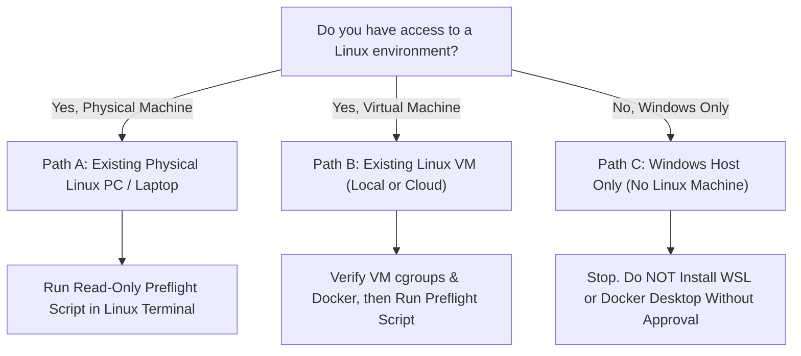

# Phase 17: Linux Access Check, Safe Transfer Planning & Readiness Review

**Project:** AI Coding Debugger  
**Project Path:** `C:\Users\honne\.gemini\antigravity\scratch\ai-coding-debugger`  
**Date:** October 19, 2026  
**Auditor Role:** Senior Application Security Engineer & Linux Container Security Specialist  
**Transfer Package:** `C:\Users\honne\.gemini\antigravity\scratch\ai-coding-debugger-transfer\ai-coding-debugger-validation-package.tar.gz`  
**Verified SHA-256:** `11a578675ffcc2025c5771b96733d60eb13bf7f56e77c5bb1e663b4f8c6ab857`  
**Linux Preflight Status:** **NOT YET VERIFIED (Awaiting Terminal Output From Linux Host)**  
**Gate Status:** **All 26 Security Gates Strictly Marked `NOT RUN`**

---

## 1. Verified Facts vs. Unverified Items

In strict adherence to truth-in-reporting and evidence-based engineering, facts independently verified on the Windows workstation are distinguished from items reported earlier or requiring Linux execution:

### A. Facts Independently Verified on Windows:
1. **Transfer Archive Exists:**  
   - File: `C:\Users\honne\.gemini\antigravity\scratch\ai-coding-debugger-transfer\ai-coding-debugger-validation-package.tar.gz`  
   - Size: **377,076 bytes (368 KB / 0.36 MB)**  
   - Source: Verified via PowerShell `Get-Item`.
2. **Transfer SHA-256 Checksum Verified:**  
   - Hash: `11a578675ffcc2025c5771b96733d60eb13bf7f56e77c5bb1e663b4f8c6ab857`  
   - Checksum File: `ai-coding-debugger-validation-package.tar.gz.sha256` (111 bytes)  
   - Source: Verified via PowerShell `Get-FileHash -Algorithm SHA256`.
3. **Archive Confidentiality Verified:**  
   - 139 clean files staged; 168 tarball entries.  
   - Verified 0 occurrences of `.env` (only `.env.example` present), 0 `.sqlite` databases/sidecars, 0 `node_modules`, 0 `*.log` files, 0 keys/certificates.  
   - Source: Verified via `tar -ztvf` inspection.
4. **Original Project Preserved:**  
   - The original project folder `ai-coding-debugger` is completely unaltered. The archive was built in a separate staging tree.  
   - Source: Directory inspection of `C:\Users\honne\.gemini\antigravity\scratch\`.
5. **Local Test Suite Passing on Windows:**  
   - 230 tests passed, 0 failed, 5 Windows platform-dependent octal skips (54.15s).  
   - Source: Verified via `npm.cmd test`.
6. **Prior Documentation Confirmed on Disk:**  
   - `phase-15-linux-transfer-preparation-report.md` (18,325 bytes)  
   - `phase-16-linux-preflight-instructions.md` (14,258 bytes)  
   - `phase-14-independent-validation-review.md` (29,942 bytes)  
   - `phase-13-security-validation-preparation-report.md` (15,821 bytes)  
   - `FINAL_COMPLETION_REPORT.md` (20,411 bytes)  
   - `docs/SECURITY.md` (8,998 bytes)  
   - Source: Verified via PowerShell `Get-Item`.

### B. Items Not Independently Rechecked / Requiring Linux Host Data:
1. **Target Linux Operating System:** Unconfirmed. No terminal output has been provided.
2. **Target Node.js Version:** Unconfirmed. Whether the target machine has Node.js $\ge 22.5.0$ installed is unknown.
3. **Target Docker Daemon Accessibility:** Unconfirmed. Whether Docker is installed, running, and accessible without `sudo` is unknown.
4. **Target cgroups Controller Status:** Unconfirmed. Whether cgroups v2 or v1 controllers (`memory`, `pids`, `cpu`) are enabled on the target kernel is unknown.
5. **Target Disk & RAM Availability:** Unconfirmed until preflight output is captured.

---

## 2. Linux Access Decision Tree (Paths A, B, and C)

Depending on what infrastructure is actually available to you, choose the applicable path below:



---

### Path A: An Existing Linux Computer with Working Docker
*(e.g., a secondary laptop, desktop, homelab server, or lab workstation running Ubuntu, Debian, Fedora, Arch, etc.)*

- **Current State:** A physical Linux installation exists with Docker installed.
- **Immediate Safe Step:**
  1. Open a terminal on that Linux machine (locally or via SSH).
  2. Run the non-destructive preflight script (Section 4 of this report).
  3. Copy the terminal output and paste it into our conversation.
  4. **Do NOT transfer files or execute Docker commands yet.** We will review the output first to verify Node.js $\ge 22.5.0$ and non-root Docker execution.

---

### Path B: An Existing Linux Virtual Machine with Working Docker
*(e.g., a pre-existing VM in VirtualBox, VMware, or an existing cloud server)*

- **Current State:** A Linux virtual machine already exists and is booted.
- **Immediate Safe Step:**
  1. Connect to the VM via SSH or console.
  2. Verify that the VM's kernel supports cgroup resource limits (especially memory swap accounting and CFS CPU bandwidth).
  3. Run the non-destructive preflight script (Section 4).
  4. Paste the terminal output here for review before transferring any files.
  5. **Do NOT transfer files or execute Docker commands yet.**

---

### Path C: Windows Workstation Only (No Existing Linux Environment)
*(You only have your current Windows 11 laptop and no secondary Linux computer or VM)*

- **Current State:** You do not have access to an existing Linux machine.
- **Immediate Safe Step:**
  1. **STOP. Do NOT install WSL 2 or Docker Desktop on Windows.**
  2. **Do NOT enable Windows features** (Hyper-V, Virtual Machine Platform) or alter BIOS/UEFI virtualization settings.
  3. **Do NOT provision a paid cloud VM.**
  4. **Explanation:**
     - Installing Docker Desktop or WSL 2 on Windows creates background hypervisors, modifies Windows network adapters, consumes 2-4 GB of RAM, and introduces background service overhead.
     - Cloud VMs require external accounts, payment methods, and ongoing billing management.
     - The AI Coding Debugger project is already fully verified for Windows operation: 230 unit/integration tests pass cleanly, the production build succeeds, and fail-closed security (`execution_unavailable`) is proven.
     - If you do not have a Linux machine, the project remains complete and safe on Windows, with all 26 Linux gates documented as `NOT RUN`.
     - Undertaking WSL 2 setup or cloud VM provisioning requires a separate, explicit planning decision and your direct approval.

---

## 3. Safe Transfer Instructions (On Hold — Do Not Execute Yet)

When a Linux host passes preflight and you authorize transfer, the following safe procedure will be executed:

### Transfer Safeguards:
- **Generic Placeholders:** Commands use `<USER>` and `<LINUX-HOST-IP>` so no private network details are hardcoded.
- **Checksum Verification Before Extraction:** The SHA-256 checksum is asserted on the Linux host prior to uncompressing.
- **Non-Extract Inspection:** Archive entries are inspected via `tar -ztvf` before extraction to confirm zero `.env` or database leakage.
- **Isolated Dedicated Directory:** Files are extracted into `/tmp/ai-coding-debugger-validation` without overwriting existing files.
- **Zero Script Execution During Transfer:** No shell scripts or build steps run during transfer verification.

### Step 1: Copy Archive and Checksum File (Windows PowerShell)
```powershell
cd C:\Users\honne\.gemini\antigravity\scratch\ai-coding-debugger-transfer
scp ai-coding-debugger-validation-package.tar.gz <USER>@<LINUX-HOST-IP>:/tmp/
scp ai-coding-debugger-validation-package.tar.gz.sha256 <USER>@<LINUX-HOST-IP>:/tmp/
```

### Step 2: Verify SHA-256 Checksum on Linux (Linux Terminal)
```bash
cd /tmp
sha256sum -c ai-coding-debugger-validation-package.tar.gz.sha256
# Expected output:
# ai-coding-debugger-validation-package.tar.gz: OK
```
*If checksum verification fails, stop immediately. Do not extract.*

### Step 3: Inspect Contents Prior to Extraction
```bash
# Verify no secret files exist (only ./.env.example)
tar -ztvf ai-coding-debugger-validation-package.tar.gz | grep -E "\.env$|\.env\."

# Verify zero SQLite databases exist (0 lines returned)
tar -ztvf ai-coding-debugger-validation-package.tar.gz | grep "\.sqlite"

# Verify zero node_modules exist (0 lines returned)
tar -ztvf ai-coding-debugger-validation-package.tar.gz | grep "node_modules"
```

### Step 4: Extract into Dedicated Directory
```bash
mkdir -p /tmp/ai-coding-debugger-validation
cd /tmp/ai-coding-debugger-validation
tar -xzf /tmp/ai-coding-debugger-validation-package.tar.gz
```

---

## 4. Linux Preflight Inspection Script

Copy and paste this entire read-only script into your Linux terminal. It does **not** install software, does **not** use `sudo`, and does **not** print private credentials:

```bash
echo "==================================================================="
echo "  AI CODING DEBUGGER — LINUX HOST PREFLIGHT INSPECTION             "
echo "==================================================================="

echo -e "\n--- [1. Host Kernel & CPU Architecture] ---"
uname -srmo
uname -m

echo -e "\n--- [2. Node.js Version & node:sqlite Compatibility] ---"
if command -v node &>/dev/null; then
  node --version
  node -e '
    const [major, minor] = process.versions.node.split(".").map(Number);
    if (major > 22 || (major === 22 && minor >= 5)) {
      console.log("[PREFLIGHT PASS] Node.js " + process.versions.node + " is compatible with native node:sqlite.");
    } else {
      console.log("[PREFLIGHT WARNING] Node.js " + process.versions.node + " is older than 22.5.0. node:sqlite strictly requires >= 22.5.0.");
    }
  '
else
  echo "[PREFLIGHT NOTICE] Node.js is not yet installed in PATH."
fi

echo -e "\n--- [3. Docker CLI Version] ---"
if command -v docker &>/dev/null; then
  docker --version
else
  echo "[PREFLIGHT FAIL] Docker CLI is not installed or not in PATH."
fi

echo -e "\n--- [4. Docker Daemon Status & User Permissions] ---"
if docker info &>/dev/null; then
  echo "[PREFLIGHT PASS] Docker daemon is running and current user has access."
else
  echo "[PREFLIGHT FAIL] Cannot connect to Docker daemon."
  echo "Check if daemon is active ('systemctl status docker') or if your user belongs to the 'docker' group."
fi

echo -e "\n--- [5. Docker Security & Runtime Configuration] ---"
if docker info &>/dev/null; then
  docker info 2>/dev/null | grep -E "Server Version|Cgroup Version|Cgroup Driver|Storage Driver|Operating System|OSType|Architecture|Security Options" || true
fi

echo -e "\n--- [6. Host Utilities & Archivers] ---"
for cmd in tar gzip sha256sum curl; do
  if command -v "$cmd" &>/dev/null; then
    echo "  [FOUND] $cmd: $(command -v "$cmd")"
  else
    echo "  [MISSING] $cmd is missing from PATH"
  fi
done

echo -e "\n--- [7. Available Disk Space & RAM] ---"
df -h /tmp .
free -m

echo -e "\n--- [8. Non-Root Docker Execution Test] ---"
if docker ps &>/dev/null; then
  echo "[PREFLIGHT PASS] Current account can execute Docker commands without sudo."
else
  echo "[PREFLIGHT FAIL] Current account cannot list containers without sudo."
fi

echo -e "\n==================================================================="
echo "  PREFLIGHT COMPLETE — REVIEW RESULTS ABOVE                        "
echo "==================================================================="
```

---

## 5. Dependency & Configuration Hold

The following operations remain **strictly on hold** and will NOT be executed until preflight output is reviewed:

1. **`npm install` / `npm ci` Hold:**  
   No package installation will be performed on Windows or Linux. When authorized on Linux, `npm install --omit=dev` will install only production dependencies (`express`, `cors`, `diff`, `cookie-parser`).
2. **`.env` Creation Hold:**  
   No `.env` file will be created on Linux until extraction is complete. When created, it will use **disposable mock configuration only**:
   ```bash
   NODE_ENV=production
   SANDBOX_MODE=container
   AI_PROVIDER=mock
   SESSION_SECRET=test-disposable-session-secret-64-character-hex-string-for-qa
   DB_PATH=/tmp/test-db/debugger.sqlite
   SANDBOX_MEMORY_LIMIT=256m
   SANDBOX_PIDS_LIMIT=64
   SANDBOX_CPUS=1.0
   ```
3. **Environment Mismatch Review:**
   - **Node.js $\ge 22.5.0$:** Required on the host for native `node:sqlite`. If the host has Node 18 or 20, SQLite will fail.
   - **Sandbox Container Image:** Builds `debian:bookworm-slim` containing isolated compilers (Python 3.11, OpenJDK 17, GCC/G++ 12). Completely decoupled from the host toolchain.

---

## 6. Security Gate Hold & Full 26-Gate Status

No Docker container builds, no container runs, no tests against untrusted code, and no test runner scripts will be executed until authorized.

All 26 gates remain strictly marked **`NOT RUN`**:

| Gate | Category | Description | Isolation Property / Assertion | Status |
| :---: | :--- | :--- | :--- | :---: |
| **A.1** | Image Build | Docker Sandbox Image Build | Non-root User `10001:10001`, Workdir `/workspace` | `NOT RUN` |
| **A.2** | Image Build | Compiler Toolchain Integrity | Python 3, Node, Java 17, GCC, G++, SQLite3 verified | `NOT RUN` |
| **B.1** | Network | Kernel Routing Table Denial | Zero routes, loopback only (abort on failure) | `NOT RUN` |
| **B.2** | Network | Outbound TCP Socket Drop | Connect to `1.1.1.1` drops with `ENETUNREACH` | `NOT RUN` |
| **B.3** | Network | Cloud Metadata Endpoint Drop | Connect to `169.254.169.254` blocked with `ENETUNREACH` | `NOT RUN` |
| **C.1** | Filesystem | Root Filesystem Immutability | Root mount `ro`; write fails with `EROFS` (abort on failure) | `NOT RUN` |
| **C.2** | Filesystem | Non-Executable `/tmp:noexec` | Script execution in `/tmp` rejected with exit 126 (`EACCES`) | `NOT RUN` |
| **C.3** | Filesystem | Isolated Writable Workspace | `/workspace` backed by isolated 64MB RAM tmpfs | `NOT RUN` |
| **C.4** | Filesystem | Read-Only Host Code Mount | `/app/code` readable by 10001, writes rejected with `EROFS` | `NOT RUN` |
| **C.5** | Filesystem | Host & Socket Invisibility | Docker socket & SSH keys completely hidden | `NOT RUN` |
| **D.1** | Privilege | Non-Root User Enforcement | Process runs as `UID 10001:GID 10001` (abort on failure) | `NOT RUN` |
| **D.2** | Privilege | Zero Linux Capabilities | All 41 capabilities stripped (`CapEff: 0000000000000000`) | `NOT RUN` |
| **D.3** | Privilege | No-New-Privileges Flag | `PR_SET_NO_NEW_PRIVS == 1` prevents SUID escalation | `NOT RUN` |
| **E.1** | Resources | 256MB Memory Cap & OOM | Allocation past 256MB triggers cgroup OOM killer (exit 137) | `NOT RUN` |
| **E.2** | Resources | 64 PID Fork-Bomb Resistance | Spawning $>64$ processes rejected with `EAGAIN` | `NOT RUN` |
| **E.3** | Resources | CPU Quota & CFS Throttling | 1.0 CPU quota verified; multiprocessing triggers throttling | `NOT RUN` |
| **E.4** | Resources | 2500ms Wall-Clock Timeout | Runaway execution forcibly terminated at 2500ms | `NOT RUN` |
| **E.5** | Resources | 64KB Buffer Truncation | Stdout clamped at 65,536 bytes with warning marker | `NOT RUN` |
| **E.6** | Resources | Ephemeral Workspace Cleanup | Host temporary execution directory purged on completion | `NOT RUN` |
| **F.1** | Application | Production Mode Locking | `NODE_ENV=production` locks runner to container | `NOT RUN` |
| **F.2** | Application | Production Fail-Closed Gate | Unavailable Docker returns `execution_unavailable` | `NOT RUN` |
| **F.3** | Application | Guest Quota & Auth Boundary | Guest quota (2 attempts) enforced in production mode | `NOT RUN` |
| **G.1** | POSIX DB | Database Directory Mode 0700 | Parent directory permissions hardened to octal `0700` | `NOT RUN` |
| **G.2** | POSIX DB | Database File Mode 0600 | Main SQLite file permissions hardened to octal `0600` | `NOT RUN` |
| **G.3** | POSIX DB | SQLite WAL/SHM Mode 0600 | Sidecars verified `0600` during active transaction | `NOT RUN` |
| **G.4** | POSIX DB | Symbolic Link Rejection | Symlinked database rejected with `SYM_LINK_DETECTED` | `NOT RUN` |

---

## 7. Outstanding Security Risks

1. **Unverified Host Kernel:** Until real preflight output is captured, we cannot verify whether the target Linux kernel has cgroups v2/v1 memory swap accounting and CFS bandwidth enabled.
2. **Host Fork & OOM Stresses:** Gate E.1 (350MB memory allocation) and Gate E.2 (75-process fork bomb) test system limits. They must never be run on a production server.
3. **Privilege Escalation Risk if Daemon Unhardened:** If the host Docker daemon is configured with insecure flags (`--insecure-registry`, unauthenticated TCP ports), container testing could expose daemon ports. The preflight check inspects daemon security options.

---

## 8. The Single Next Action Required From You

Please reply with **one** of the following:

- **Option 1 (You have an existing Linux machine or VM):**  
  Run the preflight script in **Section 4** on your Linux machine, copy the output, and paste it here.
- **Option 2 (You only have Windows and no Linux machine):**  
  Reply confirming that you only have Windows. We will maintain the current verified state (230 tests passing, production fail-closed verified) and discuss whether you want to consider an isolated disposable VM or conclude with the Windows verification evidence.
