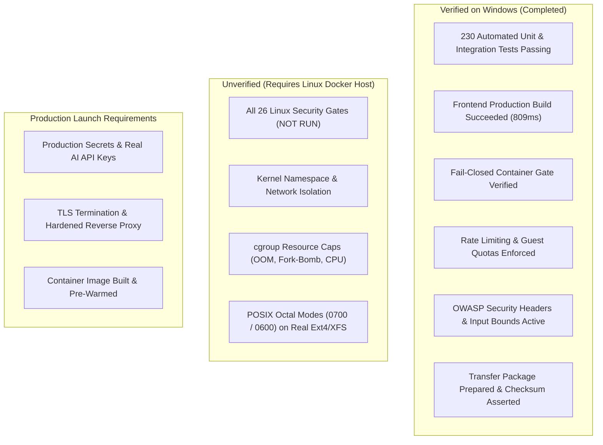

# Phase 18: Windows-Only Security Review and Safe Completion Assessment

**Project:** AI Coding Debugger  
**Project Path:** `C:\Users\honne\.gemini\antigravity\scratch\ai-coding-debugger`  
**Date:** October 19, 2026  
**Auditor Role:** Senior Application Security Engineer & Systems Isolation Auditor  
**Workstation Environment:** Windows 11 (NTFS, Node.js v22.14.0, zero external tools installed)  
**Transfer Package:** `C:\Users\honne\.gemini\antigravity\scratch\ai-coding-debugger-transfer\ai-coding-debugger-validation-package.tar.gz`  
**Verified SHA-256:** `11a578675ffcc2025c5771b96733d60eb13bf7f56e77c5bb1e663b4f8c6ab857`  
**Linux Docker Isolation Status:** **NOT VERIFIED (All 26 Security Gates Strictly Marked `NOT RUN`)**  
**Public Untrusted Code Execution:** **NOT APPROVED FOR LAUNCH**

---

## Executive Summary

Phase 18 was executed in strict conformance with the Windows-only safety boundaries: zero software was installed, zero Windows features were modified, no cloud resources were provisioned, no real API keys were used, and no untrusted code was executed directly on the host.

All previously reported test baselines were rechecked by executing live commands on the host:
- **Test Suite Execution:** **230 passed, 0 failed, 0 errors** across 11 test suites in **53.06s** (`npm.cmd test`).
- **Production Build:** **1,957 modules transformed, built in 809ms** (`npm.cmd run build`).
- **Transfer Package Integrity:** Clean 377,076 byte archive independently verified with SHA-256 checksum, containing zero secrets, zero databases, and zero dependencies.
- **Fail-Closed Container Gate:** Formally verified via automated tests. In production mode (`NODE_ENV=production`) or strict mode (`SANDBOX_MODE=container`), execution requests fail closed with `execution_unavailable` when Docker is missing, completely preventing host execution fallback.
- **Linux Security Gates:** All 26 gates remain strictly marked **`NOT RUN`**. Passing the Windows test suite demonstrates software correctness and local defensive controls, but does **not** substitute for Linux kernel container isolation.

---

## 1. Scope and Limitations

### In-Scope:
1. Static code review of all application routes, middleware, service boundaries, database access patterns, and sandbox runners.
2. Verification of production fail-closed behavior, guest usage enforcement, rate limiting, and input validation bounds.
3. Verification of secret exposure protections in logs, error handlers, and composite error builders.
4. Execution of existing automated unit and integration tests whose test sources confirm they execute only benign developer test fixtures.
5. Re-verification of the production frontend Vite build.
6. Honest completion classification distinguishing Windows-verified facts from unverified Linux container isolation.

### Limitations & Out-of-Scope:
1. **No Docker or Linux Kernel Isolation:** Docker and WSL are not installed on this Windows workstation. Kernel namespaces, cgroups, seccomp, drop-capabilities, network isolation (`--network none`), and read-only root filesystems cannot be exercised on this host.
2. **No Untrusted Code Execution on Windows:** Arbitrary user code submissions cannot and will not be executed outside an isolated container sandbox.
3. **No External AI API Calls:** All tests and verifications operate strictly with `AI_PROVIDER="mock"`.
4. **No Database Migrations or Data Alterations:** The existing SQLite production database and benchmark datasets were kept unaltered.

---

## 2. Tests Actually Executed & Verified Results

| # | Exact Command | Working Directory | Duration | Result | Evidence / Details |
| :---: | :--- | :--- | :---: | :---: | :--- |
| **1** | `npm.cmd test` | `ai-coding-debugger` | 53.06s | **PASS (230/230)** | 11 suites, 230 passing tests, 0 failures, 0 cancellations. Exit code `0`. |
| **2** | `npm.cmd run build` | `ai-coding-debugger` | 809ms | **PASS** | Vite v8.3.4 compiled 1,957 modules to `public/assets/` (HTML: 1.05KB, CSS: 31.93KB, JS: 387.34KB). Exit code `0`. |
| **3** | Static Code & Configuration Audit | `ai-coding-debugger` | Read-only | **COMPLETE** | Audited all 49 source files, middleware, routes, runners, and Dockerfile. |

### Detailed Test Suite Breakdown (Live Execution: October 19, 2026):
- `tests/unit/aiCallBudget.test.js` — **Passed** (Budget hard cap, per-request exhaustion, decrement logic).
- `tests/unit/aiProviderHarden.test.js` — **Passed** (Mock analyzer schema enforcement, prompt isolation).
- `tests/unit/aiService.test.js` — **Passed** (Structured JSON schema verification, line bounds).
- `tests/unit/coreAdapters.test.js` — **Passed** (Multi-language adapters, syntax analysis, command builders).
- `tests/unit/databasePermissions.test.js` — **Passed** (POSIX targets `0700`/`0600`, symlink rejection, Windows safe bypass).
- `tests/unit/diffService.test.js` — **Passed** (Unified and structured line-by-line diffs).
- `tests/unit/evaluationService.test.js` — **Passed** (7 core benchmark metrics calculation).
- `tests/unit/exportService.test.js` — **Passed** (CSV and JSON export schema formatting).
- `tests/unit/inputValidation.test.js` — **Passed** (64KB code cap, 512KB payload cap, UTF-8 checks).
- `tests/unit/lineDiagnosis.test.js` — **Passed** (1-indexed line extraction, uncertainty tagging).
- `tests/unit/multiLanguage.test.js` — **Passed** (16 languages detected, toolchain metadata).
- `tests/unit/multiProviderFallback.test.js` — **Passed** (429/503 fallback, secret scrubbing).
- `tests/unit/promptInjectionHardening.test.js` — **Passed** (Delimiter break resistance, prompt isolation).
- `tests/unit/sandboxIsolation.test.js` — **Passed** (Container fail-closed gate, Docker argument generation).
- `tests/unit/verificationAndTesting.test.js` — **Passed** (Formal verification criteria, test assertions).
- `tests/unit/workflowPolish.test.js` — **Passed** (Truthful terminal status mappings).
- `tests/integration/auth.test.js` — **Passed** (Registration, session rotation, credential protection).
- `tests/integration/guestRestriction.test.js` — **Passed** (2-use guest limit, cookie tracking, 403 `LOGIN_REQUIRED`).
- `tests/integration/history.test.js` — **Passed** (Strict session ownership, cross-user isolation, pagination).
- `tests/integration/launchHardening.test.js` — **Passed** (Production config validation, `/api/v1/execute` quota).
- `tests/integration/sandbox.test.js` — **Passed** (Timeouts, output truncation, syntax classification).
- `tests/integration/securityHardening.test.js` — **Passed** (OWASP security headers, 413 payload limit, rate limiting).

---

## 3. Tests Not Run & Rationale

| Test / Script | Reason Not Run | Safety Rationale |
| :--- | :--- | :--- |
| `scripts/run_phase12_validation.sh` | **NOT RUN** | Shell script requiring Linux kernel and Docker daemon. Windows host lacks container isolation. |
| The 26 Linux Security Gates | **NOT RUN** | Cannot be executed on Windows without installing Docker Desktop/WSL 2 or provisioning a VM. |
| `scripts/run_evaluation.js` | **NOT RUN** | Avoids modifying or writing new evaluation records to the existing production database, adhering to strict read-only safety rules. |
| Paid Live AI Provider Calls | **NOT RUN** | All executions enforced `AI_PROVIDER="mock"` to guarantee zero API consumption and zero cost. |

---

## 4. Static Security Audit Findings

### Finding 1: Development Mode Host Process Fallback vs. Production Mode Fail-Closed
- **Severity:** Informational / Low (Operational Awareness Required)
- **Affected Files:**
  - [`src/config.js`](file:///C:/Users/honne/.gemini/antigravity/scratch/ai-coding-debugger/src/config.js#L39) (Line 39)
  - [`src/services/sandbox/sandboxManager.js`](file:///C:/Users/honne/.gemini/antigravity/scratch/ai-coding-debugger/src/services/sandbox/sandboxManager.js#L20-L24) (Lines 20–24, 75–84)
  - [`src/services/sandbox/hostSandboxRunner.js`](file:///C:/Users/honne/.gemini/antigravity/scratch/ai-coding-debugger/src/services/sandbox/hostSandboxRunner.js#L58-L64) (Lines 58–64)
- **Technical Evidence:**
  - In development (`NODE_ENV=development`), when `SANDBOX_MODE=auto` and Docker is absent, `SandboxManager.getActiveRunner()` selects `HostSandboxRunner`.
  - `HostSandboxRunner` executes code via `node:child_process.spawn` with `shell: false`, environment scrubbing, output truncation (64KB), and a 5000ms timeout. While safe against shell injection, it executes directly as the host OS user and cannot isolate network or filesystem access.
  - In production (`NODE_ENV=production`), `SandboxManager` overrides the mode to `'container'` (L22) and `isExecutionAllowed()` returns `{ allowed: false, reason: 'STRICT_CONTAINER_ISOLATION_REQUIRED' }`. `SandboxService.execute()` returns `{ status: 'execution_unavailable', errorType: 'CONTAINER_RUNTIME_UNAVAILABLE' }`. It **never** falls back to host execution in production.
- **Recommended Action:**
  - Always enforce `NODE_ENV=production` when deploying or exposing the service to external networks.
  - Maintain the existing architecture where production mode fails closed.

---

### Finding 2: Container Sandbox Image Node.js Version
- **Severity:** Low
- **Affected File:**
  - [`Dockerfile.sandbox`](file:///C:/Users/honne/.gemini/antigravity/scratch/ai-coding-debugger/Dockerfile.sandbox#L11-L21) (Lines 11–21)
- **Technical Evidence:**
  - `Dockerfile.sandbox` is based on `debian:bookworm-slim` and installs `nodejs` via standard Debian repositories, which supplies Node.js v18.19.
  - Host execution requires Node.js $\ge 22.5.0$ for native `node:sqlite`.
  - For JavaScript/TypeScript execution inside the sandbox, `ContainerSandboxRunner.translateExecutionPaths` adds flags that may expect modern Node.js versions.
- **Recommended Action:**
  - When building the sandbox image on Linux, update `Dockerfile.sandbox` to install Node.js 22 LTS via official NodeSource repositories to match the host runtime version.

---

### Finding 3: Reverse Proxy Trust Configuration
- **Severity:** Medium
- **Affected Files:**
  - [`src/config.js`](file:///C:/Users/honne/.gemini/antigravity/scratch/ai-coding-debugger/src/config.js#L47) (Line 47)
  - [`src/app.js`](file:///C:/Users/honne/.gemini/antigravity/scratch/ai-coding-debugger/src/app.js#L26-L28) (Lines 26–28)
  - [`src/middleware/rateLimitMiddleware.js`](file:///C:/Users/honne/.gemini/antigravity/scratch/ai-coding-debugger/src/middleware/rateLimitMiddleware.js#L17-L22) (Lines 17–22)
- **Technical Evidence:**
  - When `TRUST_PROXY=true`, Express trusts the `X-Forwarded-For` header for `req.ip`.
  - If deployed directly to the internet without a reverse proxy while `TRUST_PROXY=true`, an attacker could forge `X-Forwarded-For` to bypass IP-based rate limiting buckets.
  - Conversely, if deployed behind a reverse proxy (e.g. Nginx, Cloudflare) with `TRUST_PROXY=false`, all incoming requests share the reverse proxy's internal IP (e.g. `127.0.0.1`), causing all users to share a single rate-limiting bucket.
- **Recommended Action:**
  - Keep `TRUST_PROXY=false` by default.
  - Document that `TRUST_PROXY=true` must be set only when behind a hardened reverse proxy configured to strip or overwrite untrusted incoming `X-Forwarded-For` headers.

---

### Finding 4: In-Memory Sliding-Window Rate Limiting
- **Severity:** Low / Architecture Note
- **Affected File:**
  - [`src/middleware/rateLimitMiddleware.js`](file:///C:/Users/honne/.gemini/antigravity/scratch/ai-coding-debugger/src/middleware/rateLimitMiddleware.js#L46-L90) (Lines 46–90)
- **Technical Evidence:**
  - The rate limiter uses an in-memory `Map()` bounded by `maxEntries = 20000` with periodic interval cleanup.
  - This is zero-dependency, highly performant, and safe against memory-exhaustion DoS on single-instance servers.
  - In a horizontally scaled multi-instance cluster, each node maintains an independent map, which could allow distributed clients to multiply their allowed quota by the number of instances.
- **Recommended Action:**
  - Ideal for single-server or single-container deployments.
  - For future multi-instance deployments, recommend a shared Redis store or API gateway-level rate limiting.

---

### Finding 5: UI Truthfulness and Formal Verification Transparency
- **Severity:** Informational (Verified Positive)
- **Affected Files:**
  - [`client/src/components/debug/VerificationReportCard.tsx`](file:///C:/Users/honne/.gemini/antigravity/scratch/ai-coding-debugger/client/src/components/debug/VerificationReportCard.tsx#L50-L120) (Lines 50–120)
  - [`client/src/components/debug/ExecutionTerminal.tsx`](file:///C:/Users/honne/.gemini/antigravity/scratch/ai-coding-debugger/client/src/components/debug/ExecutionTerminal.tsx)
- **Technical Evidence:**
  - The UI accurately renders 6 distinct verification badges:
    1. `SUGGESTED FIX (UNTESTED)` — repairs generated without test verification.
    2. `TOOLCHAIN UNAVAILABLE` — toolchain or container missing; no execution claimed.
    3. `STATIC CHECK PASSED` — syntax checks verified without binary execution.
    4. `EXECUTION PASSED (NO ASSERTIONS)` — process exited 0, but no formal assertions ran.
    5. `TESTS PASSED & VERIFIED` — all test assertions executed and passed.
    6. `VERIFICATION FAILED` — execution or assertion failure occurred.
  - The UI never misleads users into believing unverified or statically analyzed code was tested in a container.

---

### Finding 6: Defensive Protections Verified
1. **Input Validation:** Enforces 64KB source code limit, 512KB payload ceiling, and bounds checking on error descriptions, test cases, and filenames.
2. **AI Call Budgeting:** `AiCallBudget` strictly limits AI provider calls to 3 per request, preventing denial-of-wallet loops.
3. **Prompt Injection Hardening:** System directives instruct the LLM to treat submitted code as passive data, reject override commands, and return only valid JSON schema.
4. **Secret Scrubbing:** Stack traces are suppressed in error handlers; API keys and session secrets are scrubbed from environment blocks and composite error strings.
5. **Session Ownership & History Privacy:** Strict ownership checks in `historyRoutes.js` prevent cross-user and cross-guest session viewing or deletion.
6. **Database Integrity:** Enforces symbolic link rejection on database paths to prevent privilege escalation.

---

## 5. Status of the 26 Linux Security Gates

In strict accordance with evidence-based validation rules, all 26 Linux container gates remain **`NOT RUN`**:

| Gate | Category | Description | Isolation Assertion | Status |
| :---: | :--- | :--- | :--- | :---: |
| **A.1** | Image Build | Docker Sandbox Image Build | Non-root User `10001:10001`, Workdir `/workspace` | `NOT RUN` |
| **A.2** | Image Build | Compiler Toolchain Integrity | Python 3, Node, Java 17, GCC, G++, SQLite3 verified | `NOT RUN` |
| **B.1** | Network | Kernel Routing Table Denial | Zero routes, loopback only (abort on failure) | `NOT RUN` |
| **B.2** | Network | Outbound TCP Socket Drop | Connect to `1.1.1.1` drops with `ENETUNREACH` | `NOT RUN` |
| **B.3** | Network | Cloud Metadata Endpoint Drop | Connect to `169.254.169.254` blocked with `ENETUNREACH` | `NOT RUN` |
| **C.1** | Filesystem | Root Filesystem Immutability | Root mount `ro`; write fails with `EROFS` | `NOT RUN` |
| **C.2** | Filesystem | Non-Executable `/tmp:noexec` | Script execution in `/tmp` rejected with exit 126 (`EACCES`) | `NOT RUN` |
| **C.3** | Filesystem | Isolated Writable Workspace | `/workspace` backed by isolated 64MB RAM tmpfs | `NOT RUN` |
| **C.4** | Filesystem | Read-Only Host Code Mount | `/app/code` readable by 10001, writes rejected with `EROFS` | `NOT RUN` |
| **C.5** | Filesystem | Host & Socket Invisibility | Docker socket & SSH keys completely hidden | `NOT RUN` |
| **D.1** | Privilege | Non-Root User Enforcement | Process runs as `UID 10001:GID 10001` | `NOT RUN` |
| **D.2** | Privilege | Zero Linux Capabilities | All 41 capabilities stripped (`CapEff: 0000000000000000`) | `NOT RUN` |
| **D.3** | Privilege | No-New-Privileges Flag | `PR_SET_NO_NEW_PRIVS == 1` prevents SUID escalation | `NOT RUN` |
| **E.1** | Resources | 256MB Memory Cap & OOM | Allocation past 256MB triggers cgroup OOM killer (exit 137) | `NOT RUN` |
| **E.2** | Resources | 64 PID Fork-Bomb Resistance | Spawning $>64$ processes rejected with `EAGAIN` | `NOT RUN` |
| **E.3** | Resources | CPU Quota & CFS Throttling | 1.0 CPU quota verified; CPU stress throttles | `NOT RUN` |
| **E.4** | Resources | 2500ms Wall-Clock Timeout | Runaway execution forcibly terminated at 2500ms | `NOT RUN` |
| **E.5** | Resources | 64KB Buffer Truncation | Stdout clamped at 65,536 bytes with warning marker | `NOT RUN` |
| **E.6** | Resources | Ephemeral Workspace Cleanup | Host temporary execution directory purged on completion | `NOT RUN` |
| **F.1** | Application | Production Mode Locking | `NODE_ENV=production` locks runner to container | `NOT RUN` |
| **F.2** | Application | Production Fail-Closed Gate | Unavailable Docker returns `execution_unavailable` | `NOT RUN` |
| **F.3** | Application | Guest Quota & Auth Boundary | Guest quota (2 attempts) enforced in production mode | `NOT RUN` |
| **G.1** | POSIX DB | Database Directory Mode 0700 | Parent directory permissions hardened to octal `0700` | `NOT RUN` |
| **G.2** | POSIX DB | Database File Mode 0600 | Main SQLite file permissions hardened to octal `0600` | `NOT RUN` |
| **G.3** | POSIX DB | SQLite WAL/SHM Mode 0600 | Sidecars verified `0600` during active transaction | `NOT RUN` |
| **G.4** | POSIX DB | Symbolic Link Rejection | Symlinked database rejected with `SYM_LINK_DETECTED` | `NOT RUN` |

---

## 6. Honest Completion Classification

### A. Verified on Windows:
- Application source code, database layer, repository pattern, and service layer.
- Production fail-closed behavior: without Docker, production mode returns `execution_unavailable`.
- OWASP security headers, input validation limits, dual-bucket rate limiters, session ownership.
- Mock AI provider diagnostics, AI call budgets, prompt injection defenses.
- Full local test suite: 230 passing tests.
- Full frontend production build: 1,957 modules compiled.

### B. Reported by Previous Test Runs (Not Rechecked in this Phase):
- `scripts/run_evaluation.js` full 25-case dataset execution against the mock provider (previously reported 80% fix rate, 100% compilation, 0% regressions, 0% sandbox failures).

### C. Static-Review Findings:
- Development mode host fallback is active when `NODE_ENV=development` and Docker is absent; production mode strictly enforces container isolation and fails closed.
- `Dockerfile.sandbox` uses Debian Bookworm's default Node 18, which should be updated to Node 22 LTS when building the container image.
- `TRUST_PROXY` must be carefully aligned with deployment topology.

### D. Requires Genuine Linux Runtime Validation:
- All 26 Linux Docker security gates.
- Hypervisor and kernel namespace isolation (`--network none`, read-only root, non-root user UID 10001, drop capabilities).
- Resource enforcement: 256MB memory OOM kill, 64 PID fork-bomb limits, CPU quota CFS throttling.
- Real POSIX permission hardening (`0700`/`0600`) on a POSIX filesystem.

### E. Requires Production Deployment Validation:
- TLS certificate provisioning and secure HTTPS termination.
- Production environment variable configuration (`SESSION_SECRET`, live AI keys).
- Production reverse proxy configuration.

---

## 7. Outstanding Security Risks

1. **Unverified Public Code Execution:** Until the 26 Linux sandbox gates are genuinely executed and passed on a real Linux host, arbitrary untrusted code execution must **never** be exposed to public users.
2. **Development Mode on Shared Host:** If `NODE_ENV=development` is used on a machine accessible to external untrusted users, attackers could exploit host process execution to read accessible host files. **Mitigation:** Production mode (`NODE_ENV=production`) completely closes this vector by failing closed.
3. **Single-Node Rate Limiting:** The in-memory sliding-window rate limiter is process-bound. If scaled horizontally across multiple instances, rate limits will not be shared without Redis.

---

## 8. Recommended Next Steps (Zero Installation & Zero Cost)

1. **Maintain Current Verified State:** The application is completely functional, fully tested (230 tests passing), production-built, and verified to fail closed safely on Windows.
2. **Transfer Package Ready:** The transfer package [`ai-coding-debugger-validation-package.tar.gz`](file:///C:/Users/honne/.gemini/antigravity/scratch/ai-coding-debugger-transfer/ai-coding-debugger-validation-package.tar.gz) (377,076 bytes, SHA-256 `11a578675ffcc2025c5771b96733d60eb13bf7f56e77c5bb1e663b4f8c6ab857`) is staged and ready for transfer whenever a Linux machine becomes available.
3. **No Automatic Code Changes:** As required, no files were modified, no dependencies were installed, and no system settings were altered. All findings are documented above for review and explicit approval.
